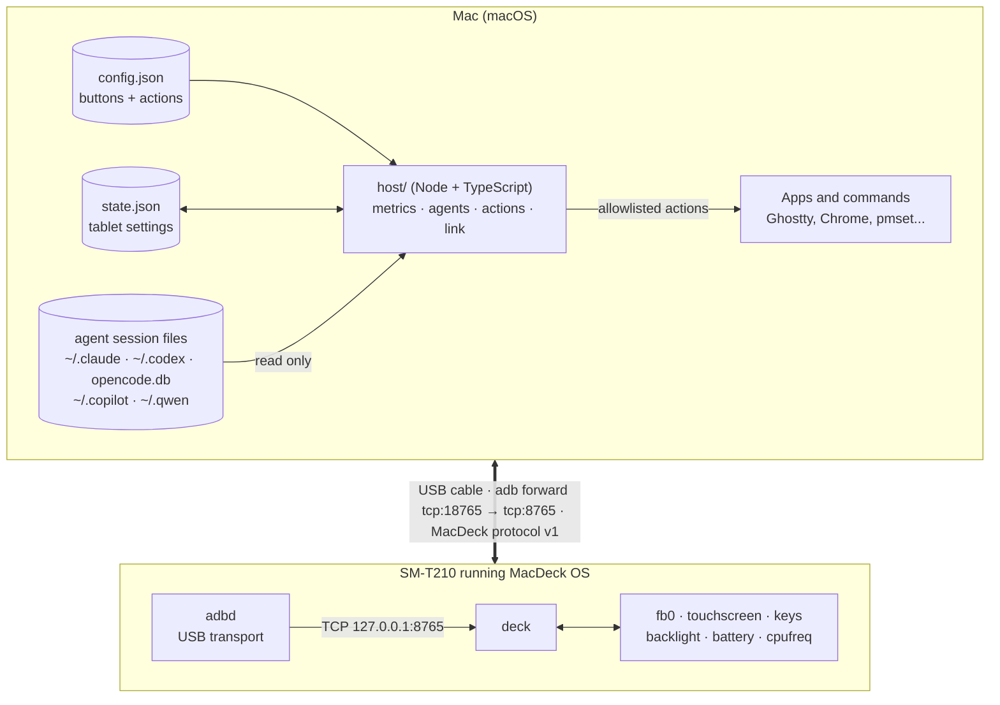
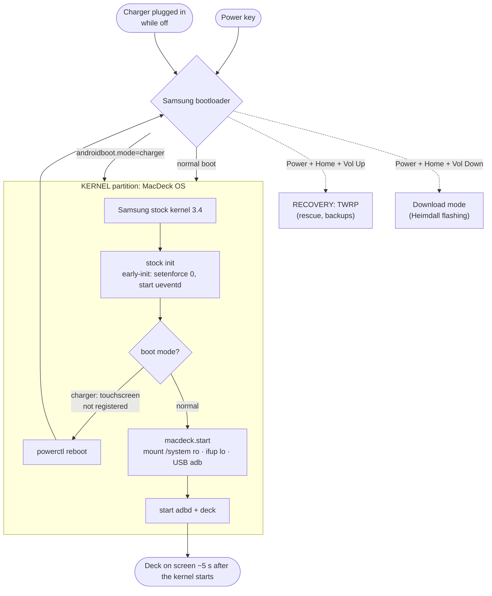
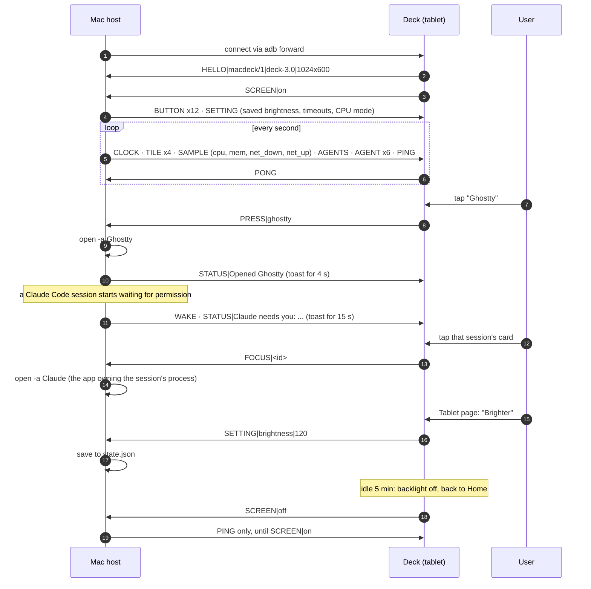
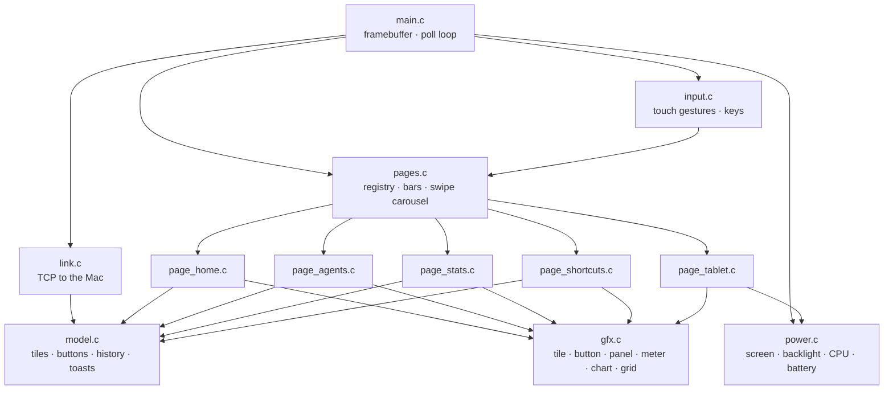
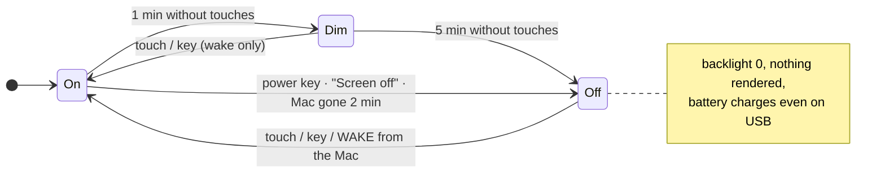
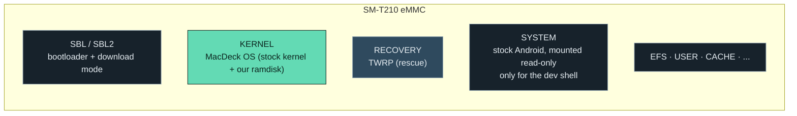

# MacDeck

Turn an old Android tablet into a dedicated touchscreen deck for a Mac: tool buttons, live system metrics, and the status of AI coding agents (Claude Code, Codex, opencode, Copilot CLI, Qwen Code). The Mac does all the real work; the tablet is only a fast, always-on display and touch surface.

Instead of running an app on top of Android, MacDeck replaces Android's entire userspace with **MacDeck OS**: the tablet's own stock Linux kernel plus a tiny ramdisk that starts a single deck program. No Android framework, no Java, no launcher. It boots straight into the deck.

> **Status: early work in progress.** MacDeck OS v3.2 is the tablet's main system. Power-on, or plugging in a powered-off tablet, boots straight into the deck.

## Pages

Swipe left/right; the pages loop around (past the last page comes Home, and back). The squares in the bottom bar show the position; tap them to open the page picker, one tile per page, and tap a tile to jump straight there. The deck returns to Home when it goes idle.

| Page | What it shows |
|---|---|
| **Home** | a summary: agent sessions (counts and the top four; tap the panel for the Agents page), CPU, memory and network, and three pinned shortcuts |
| **Agents** | up to six coding-agent sessions (Claude Code, Codex, opencode, Copilot CLI, Qwen Code): needs you, working or idle, and for how long; tap a card to open that session on the Mac |
| **Stats** | live charts (about 2 minutes) of CPU, memory and network down/up, plus a disk meter |
| **Shortcuts** | up to 12 buttons that run allowlisted actions on the Mac |
| **Tablet** | battery, power draw, brightness and system readings; brightness, dim/off timeouts, CPU mode, screen off |

Each page is one C file implementing a small interface (`render`, `hit`, `press`) on top of shared widgets (tile, button, panel, meter, chart, grid). Adding a page means writing one file and one registry entry.

## Target hardware

| | |
|---|---|
| Tablet | Samsung Galaxy Tab 3 7.0 Wi-Fi, **SM-T210** (`lt02wifi`), stock Android 4.4.2 |
| SoC | Marvell PXA986, 2× Cortex-A9, ~830 MiB RAM |
| Display / touch | 1024×600 framebuffer (32 bpp), `sec_touchscreen` multitouch |
| Host | Apple Silicon Mac (macOS) |

Other devices would need their own kernel, partition layout and quirks. The approach generalises, but the image builder is SM-T210-specific.

## How it works

The Mac does all the work: it collects metrics, owns the button layout and runs actions. The tablet runs one small C program that draws, reads touches and talks to the Mac over USB.

### System overview



- **Transport:** plain `adb forward` over the USB cable. The Mac opens the connection; the same TCP stream carries messages both ways, so `adb reverse` (unsupported by this device's adbd) is not needed. No Wi-Fi, no cloud.
- **Protocol:** one line per message, `|`-separated fields. See [protocol/PROTOCOL.md](protocol/PROTOCOL.md).
- **Safety:** the deck only ever sends a button **id**. The command it maps to lives on the Mac in `config.json`, and is run with `execFile` (no shell).

### Boot flow

MacDeck OS replaces the tablet's main boot image. The kernel is Samsung's own; the ramdisk is ours.



Measured: the kernel reaches `init` at ~4.5 s and the deck runs at ~5.1 s. Only 4 userspace processes run (`init`, `ueventd`, `adbd`, `deck`), and ~834 MB of RAM is free (stock Android idled at ~55 MB free).

### A session



### Inside the deck

Each page is one file implementing a three-function interface on top of shared widgets. Adding a page means one new file plus one line in the registry.



```c
typedef struct {
    const char *title;
    void (*render)(int ox);     // draw the content area shifted by ox (for swiping)
    int  (*hit)(int x, int y);  // control under the finger, or -1
    void (*press)(int i);       // activate a control
} Page;
```

**No Samsung or third-party binaries are stored in this repository.** `scripts/build-os-image.py` extracts the kernel and the few stock ramdisk files it reuses from a dump of *your own* device's boot partition at build time.

## Agent status

The host reads what the agents already write to disk. Nothing is installed into their configuration, and no hooks are added.

| Agent | Source | States |
|---|---|---|
| Claude Code (CLI and desktop) | `~/.claude/sessions/<pid>.json`, one file per running session | `busy`/`shell` → working, `waiting` → needs you, `idle` |
| Codex (CLI and desktop) | the newest `~/.codex/sessions/YYYY/MM/DD/rollout-*.jsonl` logs; titles from `session_index.jsonl`, else the first prompt | a turn runs between `task_started` and `task_complete` |
| opencode | `~/.local/share/opencode/opencode.db` (SQLite, opened read-only with Node's built-in `node:sqlite`) | working until the session's newest message is an `idle` one |
| GitHub Copilot CLI | `~/.copilot/session-state/<id>/events.jsonl`, folder from `workspace.yaml` | a turn runs from `user.message` / `assistant.turn_start` until `assistant.turn_end` or `session.shutdown` |
| Qwen Code | `~/.qwen/projects/<dir>/chats/<id>.jsonl` | the turn continues while the model's last message calls a tool; a text-only reply ends it |

- Up to six cards, sorted: needs you, then working, then idle; within each, the most recent first. Anything beyond six is not shown.
- One rule for every agent: a session is shown while it is working or needs you, and for 30 minutes after it goes idle; then it is removed. A session that claims to be working but has been silent for 15 minutes is treated as idle (a crashed or killed run).
- Sessions without a name are titled by their first prompt, else the project folder.
- **Tap a session card** on the Agents page and the Mac brings its app to the front. (On Home, the agents panel is one tap target that opens the Agents page.) The host walks up from the session's process to the outermost app in `/Applications`: the terminal it runs in (Ghostty, Terminal, ...) or its desktop app (Claude, ChatGPT for Codex Desktop, OpenCode). Sessions without a recorded process are matched by a running agent process with the same working folder. Only the app is activated, not a specific tab, and tmux or ssh sessions can't be traced.
- An amber **N NEEDS YOU** badge in the top bar shows on every page while any session waits for you. With more than six sessions, the last card becomes **+N more**.
- Only Claude Code reports "needs you". The others don't write permission waits to disk.
- **Other agents need their own reader.** Each tool stores its state differently, so an agent that isn't in this table won't appear. A reader is a function in `host/src/agents.ts` that returns the tool's sessions. Gemini CLI isn't supported yet: on the development Mac it never completed a turn, so there was no real log to build a reader from.
- When a session starts waiting for you, or finishes a turn, the host wakes the screen and shows a toast for 15 s (even if the screen was off). A new state has to hold for two polls in a row, to ignore flicker.
- Both sources are internal formats of those tools and may change between versions. The reader skips what it cannot parse.

## Power management

Measured on the SM-T210 over a 250 mA USB port, the backlight dominates power use:

| Backlight | Battery current |
|---|---|
| 255 | −426 mA |
| 160 | −190 mA |
| 80 (default) | −98 mA |
| 30 | −56 mA |
| off | **+78 mA (charging)** |



The deck therefore:
- defaults to brightness 80
- dims after 1 min idle and turns the backlight off after 5 min, or 2 min after the Mac disconnects
- stops rendering while off
- treats the first touch as wake-only; the power key toggles the screen
- samples sysfs every 2 s, or every 30 s while off
- sleeps in poll() for up to 1 s when idle

Without Android, the CPU governor was stuck on `userspace` at 1205 MHz. The deck switches it to `interactive`, or to `conservative` capped at 624 MHz in *saver* mode. All of these are adjustable on the Tablet page. The Mac host stores the settings (the tablet has no persistent storage) and re-sends them on connect.

## Repository layout

| Path | What |
|---|---|
| `os/deck/` | The deck program (C, static, libc only): `gfx` (drawing and widgets), `model` (state and protocol), `link`, `power`, `input`, `pages` and one `page_*.c` per page, plus a Mac-side preview renderer |
| `os/ramdisk/` | `init.rc` and `default.prop` for MacDeck OS |
| `host/` | Mac host: metrics, agent sessions, button layout, actions (`config.example.json`; your own `config.json` is git-ignored) |
| `protocol/PROTOCOL.md` | The Mac ↔ deck message format (v1) |
| `third_party/spleen/` | Spleen font license (the font is compiled into the deck) |
| `scripts/build-os-image.py` | Builds the boot image: stock kernel + our ramdisk, stock load addresses |
| `scripts/backup-partitions.sh` | Dumps every eMMC partition over ADB from TWRP, in verified, resumable chunks |
| `scripts/bdf2c.py` | Converts BDF bitmap fonts to a C header |
| `spikes/` | Small experiments (e.g. `fbtouch`, the first framebuffer + touch test) |
| `Makefile` | Builds everything |

## Build

Requirements: Android NDK (r28 tested; found via `ANDROID_NDK_HOME` or `~/Library/Android/sdk/ndk/*`) and Python 3.

```bash
make                     # build/deck (tablet) + build/deck-preview (Mac)
make preview             # render every page with sample data → build/preview-<page>.png
MACDECK_STOCK_BOOT=/path/to/KERNEL.img MACDECK_VERSION=3.0 make image   # build/macdeck-os-v3.0.img
```

`KERNEL.img` is a raw dump of the tablet's `KERNEL` partition. `scripts/backup-partitions.sh` produces one while the tablet is booted into TWRP.

## Run the Mac host

Requirements: Node 22.18+ (runs the TypeScript directly) and `adb`.

```bash
cd host
cp config.example.json config.json   # optional: your own buttons (open-app / command actions)
node src/main.ts                     # MACDECK_SERIAL=<serial> if several devices are attached
```

The host reconnects automatically. The deck greys out when the Mac goes away.

## Flashing (at your own risk)

You need [Heimdall](https://git.sr.ht/~grimler/Heimdall) (the maintained fork builds natively on Apple Silicon) and, for the backup, TWRP for `lt02`.

What ends up where on the tablet's eMMC:



1. **Back up first.** Flash TWRP to `RECOVERY`, boot it, and run `scripts/backup-partitions.sh <out-dir>`. Keep `KERNEL.img`: it is both the build input and your way back to stock Android.
2. Download mode: Power + Home + Volume Down, then Volume Up. Once MacDeck OS is running: `adb shell setprop debug.macdeck.reboot download`.
3. Test from the recovery slot first: `heimdall flash --RECOVERY build/macdeck-os-v3.0.img --no-reboot`, then boot it with Power + Home + Volume Down until the screen goes black, then immediately Power + Home + Volume Up.
4. Make it the main system: `heimdall flash --KERNEL build/macdeck-os-v3.0.img --RECOVERY twrp.img`. Stock Android will no longer boot; `heimdall flash --KERNEL KERNEL.img` restores it.

Hard-won notes:
- Samsung's stock `init` **reboots into recovery** if it can't load `/sepolicy`, or if a `critical` service keeps crashing. With MacDeck OS in `RECOVERY` that means a boot loop, so the stock policy files are kept and no service is marked critical.
- The bootloader ignores the image's own kernel cmdline, so `androidboot.selinux=permissive` does nothing. `init.rc` runs `setenforce 0` instead.
- Samsung's `adbd` stays `uid=shell` even with `ro.secure=0`, so `adb reboot download` fails. MacDeck OS exposes dev switches the shell user may set:
  - `setprop debug.macdeck.reboot download|recovery|normal|off`
  - `setprop debug.macdeck.deck stop|start`, then test builds from `/data/local/tmp` without reflashing
- Loopback is down unless something runs `ifup lo`. Without it, every adb-forwarded connection closes immediately.
- The stock kernel reports touch in portrait axes (x 0–598, y 0–1022) while the framebuffer is landscape. The deck detects this and rotates.
- While MacDeck OS lives only in `RECOVERY`, a normal power-on boots stock Android, which rewrites `RECOVERY` with stock recovery (`install-recovery.sh`). Moving MacDeck OS to `KERNEL` ends this.
- Powered off and then plugged in, the bootloader starts `KERNEL` in low-power charging mode (`androidboot.mode=charger`). Samsung's init then runs only `on charger`, and the kernel **does not register the touchscreen** (event0 becomes the power key). MacDeck OS reboots out of charger mode into a normal boot, and the deck finds the touchscreen by name.
- A weak USB cable or a bus-powered hub can make the USB link drop when VBUS sags (`mv-udc: vbus is 0`). The backup script survives this with small verified chunks.

The bootloader partitions are never written, so download mode always remains available as a way back.

## Roadmap

- [x] Safety net: Heimdall on Apple Silicon, TWRP, full verified partition backup
- [x] MacDeck OS v0: boots to our own deck program, drawing + touch, no Android
- [x] Mac link: live metrics on the deck, buttons trigger Mac actions (protocol v1)
- [x] Text rendering (Spleen bitmap font) and a first deck layout
- [x] MacDeck OS as the main system (`KERNEL`), TWRP kept in `RECOVERY`; plugging in a powered-off tablet starts the deck
- [x] Swipeable pages, tablet battery/power page, brightness/dim/off/CPU controls, idle screen-off
- [x] Home / Stats (charts) / Shortcuts / Tablet pages on a modular page interface
- [x] AI-agent status page (Claude Code, Codex, opencode, Copilot CLI, Qwen Code): needs you / working / idle, with wake-up notices
- [ ] Allow/Deny for agent permission prompts from the deck; tap a card to focus the session
- [ ] More pages as needed (notifications), context-driven page switching
- [ ] Wi-Fi transport (tablet on a wall charger)

## License

MIT. See [LICENSE](LICENSE). The Spleen font compiled into the deck is BSD-2-Clause ([third_party/spleen/LICENSE](third_party/spleen/LICENSE)). Samsung, TWRP and Heimdall are separate projects under their own licenses; none of their files are included here.
